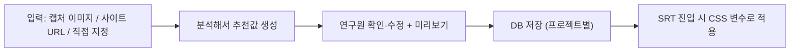

# 설문온 디자인 시스템 & SRT 브랜드 테마 메모

> 2026-10-28 대화에서 정리한 **의견/설계안**. **코드에는 아직 아무것도 적용하지 않음.**
> 관련 메모: `.agents/skills/multi-server-routing/SKILL.md` (화면별 서버 분리 + 같은 도메인 Nginx 경로 분기)

## 0. 배경 (사용자 상황)
- 설문온 프론트를 화면별로 여러 사람이 나눠 개발하고, 각자 서버에 배포 (모두 같은 도메인)
- **데이터관리 / AI오픈**: 현재 디자인 그대로 유지
- **실사관리 / 설문제작**: 새로 개발 → 새 공통 디자인 기준 적용
- **SRT**: 고객에게 보여주는 화면. **프로젝트마다 고객사 브랜드 색으로 바꿔야 함**
  (예: 맥도날드 프로젝트 → 연구원이 맥도날드 색상을 받아 SRT를 해당 색으로 보여줌)
- 추가 요구: 색상 직접 지정뿐 아니라 **웹사이트 캡처본을 넣으면 색상·폰트 등을 자동 추출해서 DB 저장**

## 1. 현재 CSS 상태 (2026-10-28 측정)
| 항목 | 수치 |
|---|---|
| CSS 파일 | 64개 (`src/assets/css/common.css` 139KB) |
| JSX 인라인 `style={{}}` | 5,247개 (136개 파일) |
| JSX 하드코딩 색상(`#xxxxxx`) | 6,826개 |
| CSS `!important` | 3,282개 |
| CSS 변수 | 331개 (`src/assets/css/theme.css`에 159개) |

- 하드코딩 색상은 대부분 Tailwind slate 계열: `#e2e8f0`, `#cbd5e1`, `#ffffff`, `#64748b`, `#2563eb`,
  `#94a3b8`, `#475569`, `#f8fafc`, `#f1f5f9`, `#334155`, `#3b82f6`, `#16a34a` → 변수 치환이 비교적 쉬움
- 이미 있는 뼈대:
  - `src/contexts/ThemeProvider.jsx`: 경로별로 `<html data-theme="...">` 지정
    (`/data_status`→`data-dashboard`, `/data_management`→`data-management`, `/ai_open_analysis`→`ai-open-analysis` 등)
  - 앱별 테마 CSS: `DataStatusTheme.css`(`--ds-primary` 등), `DataManagementTheme.css`, `FieldManagementTheme.css`
  - `src/assets/css/kendo_custom.css`

## 2. 공통 CSS / 디자인 시스템 정리안
1. **디자인 토큰 먼저 정의**: `theme.css` 기반으로 색상·폰트·간격·radius·그림자를 의미 있는 이름으로
   (`--color-border: #e2e8f0; --color-text-sub: #64748b; --color-primary: #2563eb; --radius-md; --space-2` …)
2. **공통으로 쓰는 것만 분리**: 토큰, reset/폰트, `kendo_custom.css`, 공통 컴포넌트(Sidebar, Modal, LoadingSpinner, 버튼, 테이블 헤더)
   - `common.css`를 통째로 넘기지 말 것. 진짜 공통만 골라냄
3. **배포 방식**
   - ⭐ 사내 git 저장소를 npm 패키지로 설치 (`"surveyon-ui": "git+https://...#v1.0.0"`) → 버전 관리
   - 같은 도메인 `/shared/surveyon-ui.css`를 `<link>`로 불러오기 → 가장 간단 (처음엔 이걸로 시작해도 OK)
   - 모노레포(pnpm workspace) → 각자 따로 배포하는 구조와는 잘 안 맞음
4. **새 코드 규칙**: 색상 코드 직접 사용 금지(변수만), 인라인 style은 동적 값만, 클래스명 앱별 접두어(`ds-`, `dm-`) 또는 CSS Modules,
   `!important`는 Kendo 덮어쓸 때만, (선택) stylelint로 자동 검사
5. **기존 코드는 조금씩**: 수정할 일이 생긴 파일만 정리. 많이 쓰는 색 10~15개는 일괄 치환 가능(화면 확인 필수)
6. **디자인 가이드 페이지** `/design-guide` 또는 Storybook
- 순서: 토큰 정리 → 공통 분리 → 가이드 → 배포 → 기존 코드 점진 정리

## 3. SRT 브랜드 테마 구조 (화이트라벨)
CSS를 3단계로 쌓음:
```
① 공통 기본값 (모든 앱)       회색, 폰트, 간격, radius, 그림자
② 앱별 테마 (고정)            데이터관리=보라, SRT 기본=파랑 …  ← ThemeProvider/data-theme로 이미 존재
③ 브랜드 덮어쓰기 (SRT 전용)  프로젝트별 고객사 색 → 실행 중에 ②를 덮어씀
```
- **고객사마다 CSS 파일을 만들지 않음.** 프로젝트별 색상값(JSON)을 DB에 저장하고 SRT 진입 시 `:root`에 주입
  ```js
  Object.entries(brand).forEach(([k, v]) =>
    document.documentElement.style.setProperty(`--brand-${k}`, v));
  ```
- 대표색 1~2개만 받고 나머지는 자동 생성
  ```css
  --brand-primary-hover:  color-mix(in srgb, var(--brand-primary) 85%, black);
  --brand-primary-light:  color-mix(in srgb, var(--brand-primary) 10%, white);
  --brand-primary-border: color-mix(in srgb, var(--brand-primary) 30%, white);
  ```
- 브랜드 색이 바꾸는 범위 제한
  - 바꿈: 메인 버튼, 헤더/사이드바 포인트, 선택 상태, 차트 색, 로고
  - 고정: 본문 글씨, 테두리, 배경 회색, 경고/성공 색
  - 밝은 브랜드색(노랑 등) 대비 → 글씨색(흰/검정) 자동 선택 (WCAG 4.5:1)
- 차트 라이브러리는 CSS 변수를 못 읽는 경우가 많음 → 브랜드 설정을 **React Context로도 제공**해 차트 색 배열로 전달
- **SRT 코드에서는 색상 하드코딩 금지가 필수 규칙** (안 지키면 브랜드 색이 적용 안 됨)
- 브랜드 미설정 프로젝트는 ②의 SRT 기본 파랑으로 표시

## 4. 캡처/URL 자동 추출 기능
핵심: **자동 추천값 → 연구원 확인·수정 → 저장** 흐름. 캡처에서 색상은 잘 되지만, 폰트는 "비슷한 폰트 추천" 수준.



| 입력 | 색상 | 폰트 | 방법 |
|---|---|---|---|
| 캡처 이미지 | ✅ | △ 추측 | 색 추출 라이브러리 + 비전 LLM |
| 사이트 URL ⭐ | ✅ 정확 | ✅ 실제 폰트명 | 서버에서 Puppeteer/Playwright로 사이트를 열어 실제 적용된 CSS 수집 |
| 직접 지정 | ✅ | ✅ | 컬러피커, 폰트 선택 |

- **캡처**: `node-vibrant` / `colorthief`로 주요 색 5~8개 추출 (브라우저에서 가능, 서버 불필요)
  - 색 역할(primary/secondary/배경)은 비전 LLM(GPT-4o/Gemini/Claude)에 이미지 보내 JSON으로 받기
  - 폰트는 특징("고딕, 굵은 제목")만 받아 **사용 가능한 폰트(Pretendard, Noto Sans KR, Google Fonts) 중에서 매핑** (고객사 전용 폰트는 라이선스 문제)
  - AI 리포트 쪽 기존 LLM 백엔드가 있으면 재사용
- **URL**: 버튼/헤더/링크/본문에 실제 적용된 색상·폰트를 많이 쓰인 순으로 정리, 로고·파비콘 수집 → 요청엔 없었지만 같이 제안 추천
- **후처리**: 비슷한 색 합치기, 회색·흰색·검정은 메인 색 후보에서 제외, 대비 기반 글씨색 결정, hover/light/border 자동 생성, 차트 색 6~8개 생성

## 5. DB 설계안
```sql
PROJECT_BRAND_THEME
- theme_id        PK
- project_num     FK (프로젝트)
- tokens_json     JSON     -- 실제 적용할 값
- source_type     VARCHAR  -- 'IMAGE' | 'URL' | 'MANUAL'
- source_ref      VARCHAR  -- 캡처 파일 경로 또는 URL
- extracted_json  JSON     -- 분석 원본 결과 (비교·재분석용)
- status          VARCHAR  -- 'DRAFT' | 'CONFIRMED'
- version         INT
- logo_path       VARCHAR
- created_by / created_at / updated_by / updated_at
```
```json
{
  "primary": "#DA291C", "secondary": "#FFC72C", "accent": "#27251F",
  "onPrimary": "#FFFFFF",
  "fontFamily": "Pretendard", "headingWeight": 800,
  "chart": ["#DA291C","#FFC72C","#27251F","#8A8A8A","#F5A623","#4A4A4A"],
  "radius": 8
}
```
- 분석 원본(`extracted_json`)과 최종 적용값(`tokens_json`)을 **따로 저장** → 연구원 수정 내용과 AI 추천값 비교 가능
- **CONFIRMED 상태인 테마만** 고객 화면에 노출

## 6. 연구원용 설정 화면
1. 캡처 업로드 / URL 입력 → [분석]
2. 추천 색상 칩·폰트 표시, 항목별 클릭 수정
3. 오른쪽에 SRT 미리보기 (버튼·표·차트 샘플 실시간 반영)
4. [임시 저장] / [확정]

## 7. 단계별 개발 계획
- **1차**: 직접 지정 + 캡처에서 색상만 추출(라이브러리) + DB 저장 + SRT 적용
- **2차**: 비전 LLM으로 색 역할·폰트 추천
- **3차**: URL 분석(headless 브라우저), 로고 자동 추출
- 폰트 자동 인식은 "정확한 폰트명이 아니라 비슷한 폰트를 추천하는 기능"으로 미리 기대치를 공유할 것

## 8. 작업 순서 (2026-10-28 합의)
사용자 질문: "공통 디자인 먼저 만들고, 잘 적용되면 캡처 기능 보면 되나?" → **대체로 맞음. 단, 그 앞에 '토큰 규격' 확정이 먼저.**
1. **브랜드 토큰 규격(JSON 키 목록) 확정** — 공통 CSS·DB·캡처 분석이 모두 이 규격을 기준으로 함 (계약서 역할)
2. **공통 디자인(SRT·실사관리·설문제작)** — 토큰 기반으로 작성
   - 실사관리/설문제작은 신규라 처음부터 토큰 사용 → 쉬움
   - **SRT(`src/services/dataStatus/app/hsrt`)가 가장 큰 작업**: 34개 파일에 하드코딩 색상 4,391개, 그중 브랜드 영향 받는 파란 계열 887개
     (예: `DpRequestSummaryStep.jsx`의 "요약표 자동생성" 버튼이 inline `#2563eb` + onMouseEnter로 `#eff6ff` → 브랜드 색 안 바뀜)
   - 파란 계열(`#2563eb #3b82f6 #eff6ff #bfdbfe #1d4ed8 #dbeafe #93c5fd`)만 `--brand-*`로 우선 치환, 회색은 나중
3. **검증**: 개발자도구에서 `--brand-primary`를 맥도날드 빨강 등으로 바꿔 SRT 전체가 바뀌는지 확인 (캡처 기능 없이 테스트 가능)
4. **DB 저장/조회 + 직접 지정 화면**
5. **캡처 추출** — 결과를 같은 토큰 JSON으로 채우기만 하면 됨
- 캡처 추출(색 뽑기)은 토큰 규격만 정해지면 2번과 **병렬 개발 가능** (다른 사람에게 맡겨도 됨)

## 9. 진행 상황 및 완료 내역 (2026-10-28)
- ✅ **1단계: 브랜드 테마 기반 구축 & 화면 전수 연동 완료**:
  - `src/services/dataStatus/app/hsrt/srtTheme.css` 구축:
    - 단일 브랜드 색상(`--srt-brand`) 입력 시 `color-mix()`로 25~950 전 단계 명도 자동 생성
    - `--srt-primary-*`, `--srt-secondary-*`, `--srt-accent-*`, `--srt-on-primary`
  - **SRT 전체 화면 연동**:
    - DP의뢰서, 문항추가, 교차분석, 빈도분석, 리코딩, 대시보드 권한설정, 헤더/사이드바
    - 대시보드 목록 팝업(`PageListPopup`), 집계 변수 팝업(`OverviewVariablePopup`), 보기 수정 모달(`VariablePageModal`)
    - 공통 확인 모달(`Modal.jsx`), 로딩 스피너(`LoadingSpinner.jsx`), 빈도분석 차트 툴바 및 필터 칩
  - **고유 색상 보존 및 격리 완료**:
    - 설문온 공통 상단 프로젝트 선택/등록 팝업(`.ps-modal-container`): 설문온 고유 보라색(`#5A4BFF`, `#7C3AED`) 및 Kendo 마스크 화살표 유지
    - AI 요약보고서 L1 단계: 파란색(`#2563eb`) 고정 보존
    - 삭제/에러: 빨강(`#ef4444`) 보존
- ✅ **Git 반영 완료**:
  - 커밋 해시: `c3bdfa74` ([feature] H-SRT 고객사 브랜드 테마(화이트라벨) 체계 구축 및 화면 연동)
  - `feature/srt-brand-theme` → `main` 브랜치 머지 및 `origin/main` 푸시 완료

---

## 10. 향후 로드맵: "이미지 업로드 기반 브랜드 테마 관리 웹 메뉴" 개발
> 사용자의 핵심 요구사항:
> 개발자용 일회성 분석이 아니라, **설문온 서비스 내부에 연구원/사용자가 이용할 수 있는 '브랜드 테마 설정' 메뉴/모달을 개발**하여,
> 사용자가 고객사 웹사이트 캡처 이미지를 업로드하면 시스템이 대표 색상을 자동 추출하고, 연구원이 확인/수정 후 DB에 저장하며, SRT 화면 진입 시 DB에서 불러와 자동 적용하는 정식 기능 구축.

### 전체 아키텍처 흐름
```
[1. 연구원 메뉴 진입] → [2. 캡처 이미지 업로드] → [3. 브라우저/서버 색상 추출]
        ↓
[4. 추천 색상 팔레트 & SRT 미니 미리보기] → [5. 연구원 확인/수정 후 저장]
        ↓
[6. DB 저장 (tb_project_brand_theme)] → [7. SRT 진입 시 자동 로드 & srtTheme.css 적용]
```

### 단계별 개발 계획
1. **차트 라이브러리 연동 (Next)**:
   - 교차분석/빈도분석 Kendo Chart에 브랜드 색상 배열을 주입할 `BrandThemeProvider` (React Context) 연동
2. **DB 테이블 설계 & API**:
   - `tb_project_brand_theme` (project_num, brand_name, primary_color, secondary_color, accent_color, logo_url 등)
   - 테마 저장(POST/PUT) 및 테마 조회(GET) API
3. **프론트엔드 브랜드 테마 관리 UI 개발**:
   - 대시보드 목록 또는 프로젝트 설정 내 "브랜드 테마 설정" 모달/페이지
   - 이미지 파일 드래그앤드롭 / 파일 선택 영역
   - `ColorThief` / HTML5 Canvas 기반 경량 색상 추출 (서버 비용 0원, 0.5초 즉시 추출)
   - 추출된 색상 칩 선택 및 컬러피커 미세조정 UI
   - SRT 미니 컴포넌트 실시간 미리보기 (버튼, 헤더 바, 카드)
4. **SRT 진입 시 DB 연동 자동 적용**:
   - 프로젝트 번호 기반으로 DB 테마 데이터를 조회하여 `document.documentElement`에 `--srt-brand` 주입
5. **(확장) 사이트 URL 직접 입력 크롤링 & 비전 LLM 역할 추천**:
   - URL 입력 시 백엔드 헤드리스 브라우저가 실제 CSS 수집
   - 비전 AI가 색상별 UI 역할(메인/보조/배경) 자동 매핑

---

## 11. ⚠️ 테마 & 공통 레이아웃 개발/유지보수 시 필수 주의사항 (Checklist)

> 공통 테마(`surveyon-theme.css`) 및 공통 레이아웃(`AppLayout`, `AppSidebar`) 적용 후 실제 발생했던 이슈들과 재발 방지 개발 수칙입니다.

### 1. CSS 선택자 가중치(Specificity) 관리 & 하드코딩 색상 금지
- **원인**: `surveyon-theme.css`에 `html[data-theme="hsrt"] .k-animation-container` 등 `!important`가 포함된 고가중치 전역 규칙이 정의되어 있음.
- **주의사항**:
  - 하위 컴포넌트나 개별 CSS 파일에서 `#eff6ff`, `#1d4ed8` 등의 **Hex 코드를 직접 쓰면 브랜드 테마 색상이 덮어씌워져 안 먹히는 버그가 발생**함.
  - 반드시 `var(--srt-primary-50, #eff6ff)`, `var(--srt-primary-700, #1d4ed8)`, `var(--primary-color)`처럼 **CSS 변수와 fallback 형태**로 작성할 것.
  - 브랜드 색상 전용 스타일은 `html[data-srt-brand]` 속성을 포함하여 가중치를 충분히 확보할 것.

### 2. Kendo UI 포털(Portal) 팝업 동작 특성 & 오픈 속도 최적화
- **DOM 위치 특성**:
  - Kendo `DropDownList`, `ComboBox`, `Tooltip` 등은 컴포넌트 내부 DOM이 아니라 `document.body` 직속 자식(`.k-animation-container`)으로 렌더링됨.
  - 따라서 컴포넌트 로컬 CSS(Scoped)나 단순 부모 선택자로는 스타일이 적용되지 않으며, `html[data-srt-brand] .k-animation-container ...` 형태로 전역 관리해야 함.
- **오픈 딜레이(버벅임) 방지 원칙**:
  - 그리드 내부 드롭다운에 `opened={state}`나 `onOpen={() => setState(...)}` 같은 React Controlled State를 부모 대형 모달에 연결하면, **드롭다운 클릭 1회마다 수천 라인의 부모 컴포넌트 전체가 리렌더링되어 0.5~1초의 심각한 오픈 지연이 발생**함.
  - 드롭다운은 기본 Uncontrolled로 두고, `popupSettings={{ animate: false }}`를 적용해 네이티브 0ms 즉각 팝업되도록 할 것.
- **스크롤 시 닫기 구현 시 주의사항**:
  - 팝업 컨테이너에 `element.style.display = 'none'`을 인라인으로 강제 주입하면 다음 클릭 시 팝업이 안 열리는 영구 오염 버그 발생.
  - 닫을 때는 반드시 브라우저 외부 클릭 이벤트(`document.dispatchEvent(new MouseEvent('mousedown', { bubbles: true }))`)와 `activeElement.blur()`를 사용하여 Kendo가 스스로 정상 클린업 후 닫히도록 처리할 것.

### 3. `AppSidebar.jsx` 단일화 컴포넌트 유지보수 주의점
- **집중된 책임 관리**:
  - 4대 서비스(H-SRT, 데이터관리, AI오픈, 실사관리)의 모든 사이드바 로직이 `AppSidebar.jsx` 1개로 단일화되었음.
  - 특정 서비스 전용 기능(예: 데이터관리의 기준일시 새로고침, 잔액 표시 등)을 수정할 때 다른 서비스의 사이드바 동작에 영향이 가지 않도록 `service === '...'` 조건 분기 범위를 엄격하게 격리할 것.
- **라우트 연결**:
  - 각 서비스의 메인 라우터는 `MainWrapperView` 없이 `AppLayout`을 직접 사용하며, `service` prop(`'hsrt' | 'dataManagement' | 'aiOpen' | 'fieldManagement'`)을 올바르게 전달할 것.

