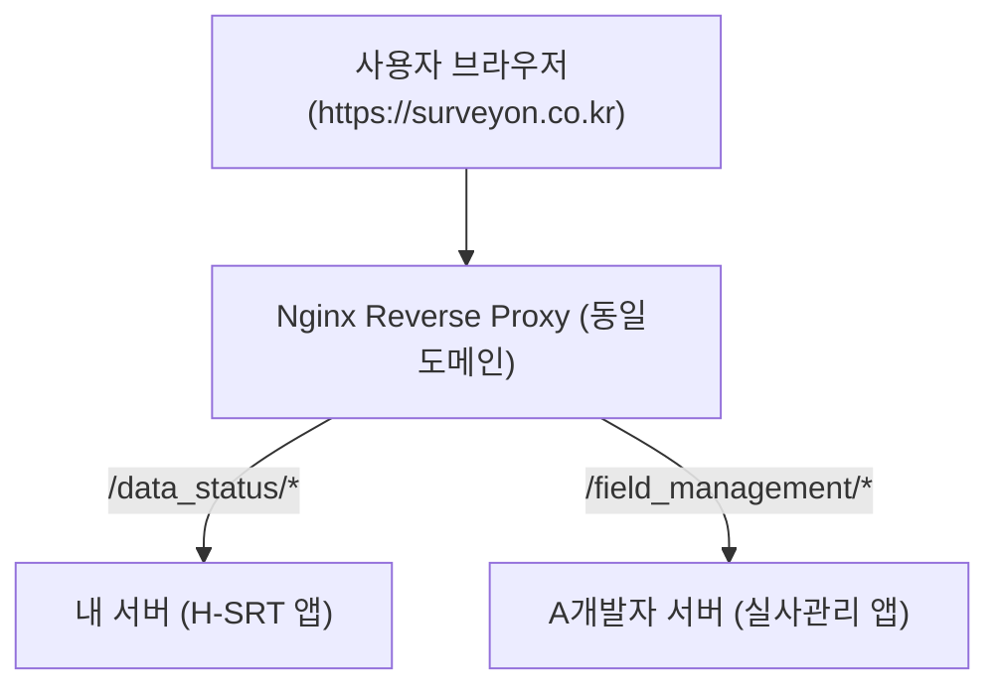

# 🚀 설문온(SulmunOn) 프론트엔드 통합 개발 가이드

> **이 문서 하나로 설문온 프론트엔드의 테마, 공통 레이아웃, 사이드바, Kendo 라이선스, 로그인 토큰 유지, 대메뉴 연동/배포까지 모든 개발 규격을 확인하실 수 있습니다.**  
> **최종 갱신일**: 2026-10-29

---

## 📌 목차
1. [4대 서비스 테마 & 공통 CSS (`surveyon-theme.css`)](#1-4대-서비스-테마--공통-css-surveyon-themecss)
2. [공통 레이아웃 컴포넌트 (`AppLayout`, `PageContainer`)](#2-공통-레이아웃-컴포넌트-applayout-pagecontainer)
3. [통합 사이드바 (`AppSidebar`) 및 메뉴 구성](#3-통합-사이드바-appsidebar-및-메뉴-구성)
4. [Kendo UI 라이선스 설정 및 활성화](#4-kendo-ui-라이선스-설정-및-활성화)
5. [로그인 상태 및 토큰(X-Auth-Token) 유지 규격](#5-로그인-상태-및-토큰x-auth-token-유지-규격)
6. [내 프로젝트에 타 개발자의 대메뉴 올리는 방법](#6-내-프로젝트에-타-개발자의-대메뉴-올리는-방법)
7. [⚠️ 프론트엔드 개발 필수 주의사항 (Checklist)](#7-️-프론트엔드-개발-필수-주의사항-checklist)

---

## 1. 4대 서비스 테마 & 공통 CSS (`surveyon-theme.css`)

설문온은 최상단(`<html>` 또는 `<body>`)의 `data-theme` 속성에 따라 각 서비스 고유의 테마 색상과 디자인 토큰을 자동으로 상속받습니다.

### 4대 대메뉴 테마 색상 표
| 서비스 명칭 | `data-theme` 키 | 대표 메인 색상 | 테마 성격 및 용도 |
| :--- | :--- | :--- | :--- |
| **H-SRT** | `hsrt` | 블루 (`#2563eb`) | 고객사 납품용 교차/빈도 통계 분석 (브랜드 화이트라벨 지원) |
| **데이터관리** | `dataManagement` | 그린 (`#16a34a`) | 데이터 맵 관리, QA, 설문 테스트 |
| **AI오픈분석** | `aiOpen` | 오렌지 (`#F97316`) | 오픈 응답 AI 정제 및 군집 분류 |
| **실사관리** | `fieldManagement` | 딥 네이비 (`#1E3A8A`) | 프로젝트 실사 진행 현황 및 응답자 통계 |

### 테마 CSS 적용 방법
1. 앱 진입점(`main.jsx` 또는 `App.jsx`) 최상단에 공통 테마 단 1줄 import:
   ```javascript
   import '@/assets/css/surveyon-theme.css';
   ```
2. **색상 작성 원칙 (절대 규칙)**:
   - CSS나 JSX 인라인 스타일에서 `#16a34a`, `#2563eb` 등 Hex 색상을 직접 쓰지 마세요.
   - 반드시 아래의 공통 CSS 변수를 사용해야 테마 변경 및 브랜드 색상이 100% 호환됩니다:
     ```css
     /* 메인 브랜드 색상 및 호버/액티브 */
     var(--primary-color)
     var(--primary-hover)
     var(--primary-focus)
     var(--primary-border)

     /* 배경 및 선택 상태 */
     var(--primary-bg-hover)      /* 연한 호버 배경 */
     var(--primary-bg-selected)   /* 연한 선택 배경 */
     ```

---

## 2. 공통 레이아웃 컴포넌트 (`AppLayout`, `PageContainer`)

설문온의 모든 화면은 **사이드바(좌측) + 헤더(20px 타이틀/툴바) + 본문(100% 핏) + 푸터(하단)**의 통일된 규격 프레임을 사용합니다.

### 컴포넌트 위치: `src/components/common/layout/`
- `AppLayout.jsx`: 4대 서비스 공통 뼈대 (사이드바 + 메인 + 푸터)
- `PageContainer.jsx`: 화면 내부 높이 100% 규격 및 내부 패딩/스크롤 컨테이너
- `PageHeader.jsx`: 공통 상단 타이틀 바 & 검색창/저장버튼 액션 툴바
- `PageFooter.jsx`: 공통 하단 푸터

### 실전 화면 개발 예시 코드
```jsx
import React from 'react';
import { PageContainer } from '@/components/common/layout';

const MyServicePage = () => {
    return (
        <PageContainer
            title="문항 관리"
            infoTooltip="문항 정보를 확인하고 조건을 설정합니다."
            onSearch={(text) => console.log('검색:', text)}
            onSave={() => console.log('저장')}
            headerActions={
                <button className="cmn-btn cmn-btn-primary">
                    + 신규 등록
                </button>
            }
        >
            {/* 본문 콘텐츠 (자동으로 상단 헤더를 제외한 영역 100% 채움) */}
            <div className="my-content-grid">
                {/* 테이블 또는 작업 영역 */}
            </div>
        </PageContainer>
    );
};

export default MyServicePage;
```

### 공통 버튼 클래스 (`cmn-btn`)
`PageLayout.css`에 내장된 공통 버튼 클래스로, 서비스 테마 색상을 자동으로 반영합니다:
- `className="cmn-btn cmn-btn-primary"`: 서비스 메인 색상 채움 버튼
- `className="cmn-btn cmn-btn-secondary"`: 연한 회색 보조 버튼
- `className="cmn-btn cmn-btn-outline"`: 테두리 버튼
- `className="cmn-btn cmn-btn-danger"`: 위험/삭제 전용 빨간 버튼

---

## 3. 통합 사이드바 (`AppSidebar`) 및 메뉴 구성

과거 서비스별로 복사되어 4개로 흩어져 있던 메뉴바 파일들이 [`AppSidebar.jsx`](file:///d:/User_Data/Desktop/프로젝트/설문온/surveyon/src/components/common/sidebar/AppSidebar.jsx) **1개 파일로 단일화**되었습니다.

### 라우터에 대메뉴 연결 방법
`App.jsx`에서 `AppLayout`의 `service` prop에 서비스 키를 전달하면, 해당 서비스의 사이드바 메뉴와 테마가 즉시 자동 연결됩니다:

```jsx
import { Routes, Route } from 'react-router-dom';
import { AppLayout } from '@/components/common/layout';
import MyDataPage from '@/services/dataManagement/MyDataPage';

function App() {
    return (
        <Routes>
            {/* 데이터관리 서비스 라우트 등록 */}
            <Route element={<AppLayout service="dataManagement" />}>
                <Route path="/data_management/map" element={<MyDataPage />} />
                <Route path="/data_management/qa" element={<QaPage />} />
            </Route>

            {/* 실사관리 서비스 라우트 등록 */}
            <Route element={<AppLayout service="fieldManagement" />}>
                <Route path="/field_management/progress" element={<ProgressPage />} />
            </Route>
        </Routes>
    );
}
```

### 사이드바 메뉴 수정/추가 규칙
- 메뉴 목록이나 서브메뉴를 추가할 때는 `src/components/common/sidebar/AppSidebar.jsx`의 메뉴 정의 배열을 수정합니다.
- 특정 서비스 전용 기능(예: 데이터관리의 기준일시 새로고침, 잔액 조회 등)을 작업할 때는 `if (service === 'dataManagement')` 와 같이 조건 분기하여 다른 서비스에 사이드이펙트가 없도록 격리합니다.

---

## 4. Kendo UI 라이선스 설정 및 활성화

설문온에서 사용하는 Kendo UI React 컴포넌트(`@progress/kendo-react-*`)는 유료 상용 라이브러리로, 라이선스가 활성화되어 있어야 개발 및 빌드 시 워터마크 배너가 표시되지 않습니다.

### 1) 라이선스 파일 배치
프로젝트 최상위 루트 디렉토리에 **`telerik-license.txt`** 파일이 반드시 존재해야 합니다.
```
설문온 프로젝트 루트/
├── src/
├── package.json
└── telerik-license.txt   <-- [필수 파일]
```

### 2) 새 개발자 PC 또는 신규 프로젝트 초기 세팅 방법
신규 프로젝트를 세팅하거나 패키지를 새로 설치했을 때 아래 순서대로 실행합니다:
```bash
# 1. 패키지 설치
npm install

# 2. Kendo 라이선스 활성화 (루트의 telerik-license.txt 자동 인식)
npx kendo-ui-license activate

# 3. 로컬 개발 서버 실행
npm run dev
```

### 3) CI/CD 배포 서버 (Jenkins) 환경 설정
Jenkins 빌드 머신이나 Docker 배포 환경에서는 다음 중 하나로 라이선스를 주입합니다:
- **방법 A**: 프로젝트 루트에 `telerik-license.txt` 파일을 복사해 둔 후 빌드 실행
- **방법 B**: 배포 서버 환경변수에 `TELERIK_LICENSE` 등록 (값: `telerik-license.txt` 내부의 텍스트 토큰)

---

## 5. 로그인 상태 및 토큰(X-Auth-Token) 유지 규격

설문온은 사용자가 로그인하면 **쿠키(Cookie)**, **LocalStorage**, **SessionStorage**의 3단계로 인증 및 프로젝트 컨텍스트를 유지합니다.

### 1) 인증 토큰 저장 위치 및 명칭
- **쿠키 (전역 공유, Path: `/`)**:
  - `TOKEN`: 사용자 고유 세션 로그인 키
  - `X-Auth-Token`: 백엔드 API 요청 시 헤더에 전송되는 인증 토큰
  - 쿠키의 `path: "/"` 로 설정되어 있으므로 **같은 도메인의 모든 대메뉴/서브페이지에서 토큰이 공유**됩니다.
- **LocalStorage (`redux-persist`)**:
  - 사용자 프로필, 기본 권한 정보
- **SessionStorage**:
  - `projectnum`: 현재 작업 중인 프로젝트 번호
  - `groupcode`: 설문 그룹 코드
  - `merge_pn`: 병합 프로젝트 번호

### 2) API 요청 시 토큰 주입 규격 (Axios Interceptor)
타 개발자가 신규 API 통신을 작성할 때는 쿠키에서 토큰을 꺼내 헤더에 주입해야 합니다:
```javascript
import Cookies from 'js-cookie';
import axios from 'axios';

const apiClient = axios.create({
    baseURL: import.meta.env.VITE_API_BASE_URL,
});

apiClient.interceptors.request.use((config) => {
    const token = Cookies.get('X-Auth-Token') || Cookies.get('TOKEN');
    if (token) {
        config.headers['X-Auth-Token'] = token;
        config.headers['Authorization'] = `Bearer ${token}`;
    }
    return config;
});
```

---

## 6. 내 프로젝트에 타 개발자의 대메뉴 올리는 방법

설문온의 화면을 여러 개발자가 각자 나눠 개발한 뒤, 최종적으로 하나의 서비스처럼 통합할 때 사용하는 **2가지 표준 연동 방식**입니다.

### 🌟 방식 A. Git 브랜치/패키지 단일 통합 방식 (추천: 완벽한 SPA)
각자 개발한 폴더를 우리 프로젝트의 `src/services/` 아래에 넣고 라우터로 연결하는 가장 깔끔한 방식입니다.

1. **폴더 배치**:
   - 개발자의 소스를 `src/services/신규메뉴명/` 에 배치
2. **라우터 등록 (`src/App.jsx`)**:
   ```jsx
   import { AppLayout } from '@/components/common/layout';
   import NewMenuPage from '@/services/newMenu/NewMenuPage';

   <Route element={<AppLayout service="dataManagement" />}>
       <Route path="/new_menu/*" element={<NewMenuPage />} />
   </Route>
   ```
3. **장점**: 페이지 이동 시 새로고침이 전혀 없고, Redux/로그인 토큰이 100% 매끄럽게 유지됨.

---

### 🌐 방식 B. 별도 서버 분리 배포 시 (Nginx 리버스 프록시 방식)
A개발자가 완전히 다른 독립된 서버(포트)에 자체 빌드하여 배포하고, 사용자는 같은 창에서 메뉴를 이동할 때 사용하는 방식입니다.



#### 1) Nginx 설정 (경로 분기)
```nginx
server {
    listen 80;
    server_name surveyon.co.kr;

    # H-SRT 및 기본 메인 앱
    location / {
        proxy_pass http://127.0.0.1:3000;
    }

    # 개발자의 독립 배포 앱 (실사관리)
    location /field_management/ {
        proxy_pass http://127.0.0.1:3001;
    }
}
```

#### 2) 개발자의 `vite.config.js` 설정
```javascript
export default defineConfig({
    base: '/field_management/', // 본인 배포 경로를 base로 지정
});
```

#### 3) 다른 서버 화면으로 이동할 때의 코드 (중요)
- 같은 앱 내부 이동: `navigate('/page')` (SPA 방식)
- **다른 개발자 서버로 이동 시**: `window.location.href = '/field_management'` (같은 탭 URL 이동)
- **로그인 상태**: 동일 도메인이므로 쿠키(`TOKEN`, `X-Auth-Token`)와 `sessionStorage`가 **풀리지 않고 그대로 유지**됩니다!

---

## 7. ⚠️ 프론트엔드 개발 필수 주의사항 (Checklist)

개발 중 빈번하게 발생할 수 있는 이슈 방지 체크리스트입니다.

### 1. Hex 색상 직접 하드코딩 금지
- `surveyon-theme.css`의 전역 가중치로 인해 `#eff6ff`, `#1d4ed8` 등을 직접 쓰면 **고객사 브랜드 테마(초록, 빨강 등)가 먹지 않는 버그**가 발생합니다.
- 항상 `var(--primary-color)`, `var(--srt-primary-*)` 변수를 사용하세요.

### 2. Kendo 드롭다운 클릭 지연(버벅임) 방지
- 그리드 내 드롭다운에 `opened={state}` 같은 부모 Controlled State를 쓰면 **클릭할 때마다 수천 라인의 부모 컴포넌트가 리렌더링되어 0.5~1초 딜레이**가 발생합니다.
- 반드시 **Uncontrolled** + `popupSettings={{ animate: false }}`로 설정해 0ms 즉각 오픈되도록 작성하세요.

### 3. 스크롤 시 드롭다운 닫기 구현 시 DOM 오염 주의
- 팝업 컨테이너에 `style.display = 'none'`을 강제로 주입하면 다음 클릭 시 팝업이 다시 열리지 않는 버그가 생깁니다.
- 브라우저 외부 클릭 이벤트(`mousedown`, `pointerdown`)와 `blur()`를 dispatch하여 Kendo가 자체적으로 정상 클린업 후 닫히도록 해야 합니다.
