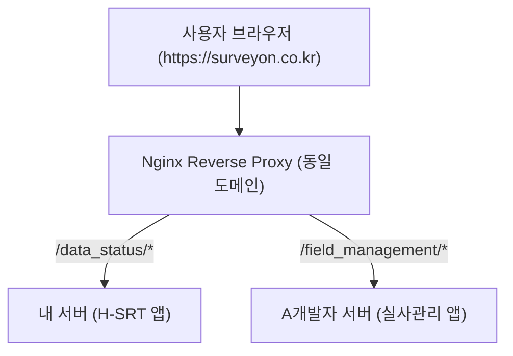

# 🚀 설문온(SulmunOn) 프론트엔드 통합 개발 가이드 (심화 레퍼런스)

> **이 문서는 설문온 프론트엔드의 4대 테마 토큰, 크롤링/E2E 자동화 테스트용 표준 ID 전체 명세, Kendo CI/CD 라이선스, 인증 쿠키/세션 구조, Nginx 멀티서버 배포 아키텍처를 다루는 심화 레퍼런스 문서입니다.**  
> - 빠른 초기 세팅 및 코드 템플릿은 **`DEVELOPER_QUICK_START.md`**를 먼저 확인하세요.  
> - AI 코딩 에이전트용 핵심 제약조건은 **`AI_CODING_RULES.md`**를 참고하세요.

---

## 📌 목차
1. [4대 서비스 테마 & 공통 CSS (`surveyon-theme.css`)](#1-4대-서비스-테마--공통-css-surveyon-themecss)
2. [공통 레이아웃 컴포넌트 (`AppLayout`, `PageContainer`)](#2-공통-레이아웃-컴포넌트-applayout-pagecontainer)
3. [통합 사이드바 (`AppSidebar`) 및 메뉴 구성](#3-통합-사이드바-appsidebar-및-메뉴-구성)
4. [Kendo UI 라이선스 설정 및 활성화](#4-kendo-ui-라이선스-설정-및-활성화)
5. [로그인 상태 및 토큰(X-Auth-Token) 유지 규격](#5-로그인-상태-및-토큰x-auth-token-유지-규격)
6. [내 프로젝트에 타 개발자의 대메뉴 올리는 방법](#6-내-프로젝트에-타-개발자의-대메뉴-올리는-방법)
7. [⚠️ 프론트엔드 개발 필수 주의사항 (Checklist)](#7-️-프론트엔드-개발-필수-주의사항-checklist)

---

## 1. 4대 서비스 테마 & 공통 CSS (`surveyon-theme.css`)

설문온은 최상단(`<html>` 또는 `<body>`)의 `data-theme` 속성에 따라 각 서비스 고유의 테마 색상과 디자인 토큰을 자동으로 상속받습니다.

### 4대 대메뉴 테마 색상 표
| 서비스 명칭 | `data-theme` 키 | 대표 메인 색상 | 테마 성격 및 용도 |
| :--- | :--- | :--- | :--- |
| **H-SRT** | `hsrt` | 블루 (`#2563eb`) | 고객사 납품용 교차/빈도 통계 분석 (브랜드 화이트라벨 지원) |
| **데이터관리** | `dataManagement` | 그린 (`#16a34a`) | 데이터 맵 관리, QA, 설문 테스트 |
| **AI오픈분석** | `aiOpen` | 오렌지 (`#F97316`) | 오픈 응답 AI 정제 및 군집 분류 |
| **실사관리** | `fieldManagement` | 딥 네이비 (`#1E3A8A`) | 프로젝트 실사 진행 현황 및 응답자 통계 |

### 테마 CSS 적용 방법
1. 앱 진입점(`main.jsx`) 최상단에 공통 테마 단 1줄 import:
   ```javascript
   import 'surveyon-common/assets/css/surveyon-theme.css';
   ```
2. **색상 작성 원칙 (절대 규칙)**:
   - CSS나 JSX 인라인 스타일에서 `#16a34a`, `#2563eb` 등 Hex 색상을 직접 쓰지 마세요.
   - 반드시 아래의 공통 CSS 변수를 사용해야 테마 변경 및 브랜드 색상이 100% 호환됩니다:
     ```css
     /* 메인 브랜드 색상 및 호버/액티브 */
     var(--primary-color)
     var(--primary-hover)
     var(--primary-focus)
     var(--primary-border)

     /* 배경 및 선택 상태 */
     var(--primary-bg-hover)      /* 연한 호버 배경 */
     var(--primary-bg-selected)   /* 연한 선택 배경 */
     ```

---

## 2. 공통 레이아웃 컴포넌트 (`AppLayout`, `PageContainer`)

설문온의 모든 화면은 **사이드바(좌측) + 헤더(20px 타이틀/툴바) + 본문(100% 핏) + 푸터(하단)**의 통일된 규격 프레임을 사용합니다.

### 컴포넌트 위치: `src/components/common/layout/`
- `AppLayout.jsx`: 4대 서비스 공통 뼈대 (사이드바 + 메인 + 푸터)
- `PageContainer.jsx`: 화면 내부 높이 100% 규격 및 내부 패딩/스크롤 컨테이너
- `PageHeader.jsx`: 공통 상단 타이틀 바 & 검색창/저장버튼 액션 툴바
- `PageFooter.jsx`: 공통 하단 푸터

### 실전 화면 개발 예시 코드
```jsx
import React from 'react';
import { PageContainer } from 'surveyon-common';

const MyServicePage = () => {
    return (
        <PageContainer
            title="문항 관리"
            infoTooltip="문항 정보를 확인하고 조건을 설정합니다."
            onSearch={(text) => console.log('검색:', text)}
            onSave={() => console.log('저장')}
            headerActions={
                <button className="cmn-btn cmn-btn-primary">
                    + 신규 등록
                </button>
            }
        >
            {/* 본문 콘텐츠 (자동으로 상단 헤더를 제외한 영역 100% 채움) */}
            <div className="my-content-grid">
                {/* 테이블 또는 작업 영역 */}
            </div>
        </PageContainer>
    );
};

export default MyServicePage;
```

### 공통 버튼 클래스 (`cmn-btn`)
`PageLayout.css`에 내장된 공통 버튼 클래스로, 서비스 테마 색상을 자동으로 반영합니다:
- `className="cmn-btn cmn-btn-primary"`: 서비스 메인 색상 채움 버튼
- `className="cmn-btn cmn-btn-secondary"`: 연한 회색 보조 버튼
- `className="cmn-btn cmn-btn-outline"`: 테두리 버튼 (시그니처 라인)
- `className="cmn-btn cmn-btn-danger"`: 위험/삭제 전용 빨간 버튼
- `className="cmn-btn cmn-btn-sm"`: 28px 소형 버튼

```jsx
// 버튼 실무 사용 예시
<button type="button" className="cmn-btn cmn-btn-primary" onClick={handleSave}>
  <Save size={15} />
  <span>저장</span>
</button>
<button type="button" className="cmn-btn cmn-btn-outline" onClick={handleAdd}>
  <Plus size={15} />
  <span>행 추가</span>
</button>
```

### 📊 Kendo Grid 높이 100% 핏(Fit) 배치 공식
화면 크기에 맞춰 그리드가 스크롤 영역을 꽉 채우도록 작성하는 표준 규격입니다:
```jsx
<PageContainer title="사용자 목록" contentPadding={true}>
  {/* wrapper에 height: 100% 및 flex: 1 부여 */}
  <div style={{ height: '100%', width: '100%', display: 'flex', flexDirection: 'column' }}>
    <Grid
      style={{ height: '100%' }}
      data={dataList}
      pageable={true}
      sortable={true}
    >
      <GridColumn field="id" title="번호" width="80px" />
      <GridColumn field="name" title="이름" />
      <GridColumn field="role" title="권한" />
    </Grid>
  </div>
</PageContainer>
```
> **자동 테마 연동**: `surveyon-theme.css`가 적용되어 있으므로 그리드의 헤더, 행 호버(Hover), 행 선택(`k-selected`) 색상이 대메뉴 테마에 맞춰 **자동으로 100% 연동**됩니다.

### 🔔 전역 모달(Modal) & 로딩 스피너(LoadingSpinner) 사용법
설문온 표준 알림/확인 팝업은 브라우저 기본 `alert()` 대신 `modalContext`를 사용합니다:
```jsx
import { useContext } from 'react';
import { modalContext, loadingSpinnerContext } from 'surveyon-common';

const MyPage = () => {
  const modal = useContext(modalContext);
  const loading = useContext(loadingSpinnerContext);

  const onSubmit = async () => {
    modal.showConfirm("확인", "정말 저장하시겠습니까?", {
      btns: [
        { title: "취소" },
        {
          title: "저장",
          click: async () => {
            try {
              loading.show();
              await saveData();
              modal.showAlert("알림", "성공적으로 저장되었습니다.");
            } catch (e) {
              // 첫 번째 인자는 에러코드(status), 두 번째 인자는 에러 메시지
              modal.showErrorAlert("ERR", "저장에 실패했습니다.");
            } finally {
              loading.hide();
            }
          }
        }
      ]
    });
  };
};
```

### 🎯 크롤링 및 E2E 테스트 자동화용 고유 ID 규격
화면 자동화 테스트(Selenium, Playwright, Puppeteer 등) 및 데이터 크롤링을 위해 모든 공통 레이아웃 컴포넌트의 핵심 영역에 표준 고유 `id`가 부여되어 있습니다:

| 컴포넌트 | 대상 태그 / 영역 | 기본 부여 `id` | 설명 및 테스트 활용 |
| :--- | :--- | :--- | :--- |
| **`AppLayout`** | 전체 루트 프레임 | `id="app-root"` | 최상위 컨테이너 (`id` prop으로 커스텀 가능) |
| **`AppLayout`** | 메인 우측 섹션 | `id="app-layout-main"` | 사이드바를 제외한 우측 전체 레이아웃 |
| **`AppLayout`** | 페이지 본문 래퍼 | `id="app-main-content"` | 라우터 Outlet/페이지가 렌더링되는 중앙 영역 |
| **`PageContainer`** | 화면 최상위 `<main>` | `id="page-container"` | 개별 화면 최상위 컨테이너 (`id` prop 가능) |
| **`PageContainer`** | 실제 작업 본문 | `id="page-content"` | 그리드/테이블이 위치하는 메인 스크롤 캔버스 |
| **`PageHeader`** | 상단 타이틀 바 | `id="page-header"` | 상단 바 전체 (`id` prop 가능) |
| **`PageHeader`** | 좌측 타이틀 영역 | `id="page-header-left"` | 제목 및 도움말 툴팁 |
| **`PageHeader`** | 검색창 input | `id="page-search-input"` | 검색어 자동 입력 및 조회 테스트 |
| **`PageHeader`** | 우측 액션 버튼 모음 | `id="page-header-actions"` | 버튼 모음 래퍼 |
| **`PageHeader`** | [추가] 버튼 | `id="page-header-add-btn"` | 신규 행/데이터 추가 버튼 클릭 |
| **`PageHeader`** | [삭제] 버튼 | `id="page-header-delete-btn"` | 선택 행/데이터 삭제 버튼 클릭 |
| **`PageHeader`** | [저장] 버튼 | `id="page-header-save-btn"` | 저장/적용 버튼 클릭 |
| **`AppSidebar`** | 사이드바 `<aside>` | `id="app-sidebar"` | 좌측 네비게이션 바 전체 |
| **`AppSidebar`** | 사이드바 헤더 | `id="app-sidebar-header"` | 홈 버튼, 모듈 스위처 메뉴, 로고 영역 |
| **`AppSidebar`** | 사이드바 메뉴 네비 | `id="app-sidebar-nav"` | 전체 스크롤 메뉴 리스트 |
| **`AppSidebar`** | 사이드바 푸터 | `id="app-sidebar-footer"` | 사용자 프로필 및 로그아웃 영역 |
| **`PageFooter`** | 하단 푸터 `<footer>` | `id="app-footer"` | 카피라이트 및 시스템 운영 상태 |

---

---

## 3. 통합 사이드바 (`AppSidebar`) 및 메뉴 구성

과거 서비스별로 복사되어 4개로 흩어져 있던 메뉴바 파일들이 [`AppSidebar.jsx`](file:///d:/User_Data/Desktop/프로젝트/설문온/surveyon/src/components/common/sidebar/AppSidebar.jsx) **1개 파일로 단일화**되었습니다.

### 라우터에 대메뉴 연결 방법
`App.jsx`에서 `AppLayout`의 `service` prop에 서비스 키를 전달하면, 해당 서비스의 사이드바 메뉴와 테마가 즉시 자동 연결됩니다:

```jsx
import { Routes, Route } from 'react-router-dom';
import { AppLayout } from '@/components/common/layout';
import MyDataPage from '@/services/dataManagement/MyDataPage';

function App() {
    return (
        <Routes>
            {/* 데이터관리 서비스 라우트 등록 */}
            <Route element={<AppLayout service="dataManagement" />}>
                <Route path="/data_management/map" element={<MyDataPage />} />
                <Route path="/data_management/qa" element={<QaPage />} />
            </Route>

            {/* 실사관리 서비스 라우트 등록 */}
            <Route element={<AppLayout service="fieldManagement" />}>
                <Route path="/field_management/progress" element={<ProgressPage />} />
            </Route>
        </Routes>
    );
}
```

### 사이드바 메뉴 커스터마이징 규칙 (`node_modules` 수정 금지)
- 공통 패키지(`surveyon-common`) 설치 환경에서는 `node_modules` 내부의 `AppSidebar.jsx`를 직접 수정하지 않습니다.
- 각 프로젝트의 `src/App.jsx`에서 `<AppLayout service="..." sidebarProps={{ brand, menuGroups }} />` 형태로 `sidebarProps`를 전달하여 해당 서비스의 좌측 메뉴와 로고 클릭 이동 경로를 오버라이드합니다:
```jsx
const sidebarProps = useMemo(() => ({
  brand: {
    title: '실사관리',
    onClick: () => navigate('/field_management/main'),
  },
  menuGroups: [
    {
      label: '',
      items: [
        { label: '문항별집계', path: '/field_management/main', icon: Grid },
        { label: '쿼터관리', icon: ClipboardList, isPending: true },
      ],
    },
  ],
}), [navigate]);

<Route element={<AppLayout service="fieldManagement" sidebarProps={sidebarProps} />}>
  <Route path="/" element={<Navigate to="/field_management/main" replace />} />
  <Route path="/field_management" element={<Navigate to="/field_management/main" replace />} />
  <Route path="/field_management/main" element={<MainPage />} />
  <Route path="/field_management/*" element={<Navigate to="/field_management/main" replace />} />
</Route>
```
- **서비스별 표준 베이스 경로 및 메인/사이드바(☰) 기본 진입 경로**:
  - `hsrt` (H-SRT): 베이스 `/data_status` / 진입 경로 `/data_status`
  - `dataManagement` (데이터관리): 베이스 `/data_management` / 진입 경로 `/data_management`, `/data_management/setting/map`
  - `aiOpen` (AI오픈분석): 베이스 `/ai_open_analysis` / 진입 경로 `/ai_open_analysis`
  - `fieldManagement` (실사관리): 베이스 `/field_management` / 진입 경로 `/field_management`, `/field_management/analysis/progress`

---

## 4. Kendo UI 라이선스 설정 및 활성화

설문온에서 사용하는 Kendo UI React 컴포넌트(`@progress/kendo-react-*`)는 유료 상용 라이브러리로, 라이선스가 활성화되어 있어야 개발 및 빌드 시 워터마크 배너가 표시되지 않습니다.

### 1) 라이선스 파일 배치
프로젝트 최상위 루트 디렉토리에 **`telerik-license.txt`** 파일이 반드시 존재해야 합니다.
```
설문온 프로젝트 루트/
├── src/
├── package.json
└── telerik-license.txt   <-- [필수 파일]
```

### 2) 새 개발자 PC 또는 신규 프로젝트 초기 세팅 방법
신규 프로젝트를 세팅하거나 패키지를 새로 설치했을 때 아래 순서대로 실행합니다:
```bash
# 1. 패키지 설치
npm install

# 2. Kendo 라이선스 활성화 (루트의 telerik-license.txt 자동 인식)
npx kendo-ui-license activate

# 3. 로컬 개발 서버 실행
npm run dev
```

### 3) CI/CD 배포 서버 (Jenkins) 환경 설정
Jenkins 빌드 머신이나 Docker 배포 환경에서는 다음 중 하나로 라이선스를 주입합니다:
- **방법 A**: 프로젝트 루트에 `telerik-license.txt` 파일을 복사해 둔 후 빌드 실행
- **방법 B**: 배포 서버 환경변수에 `TELERIK_LICENSE` 등록 (값: `telerik-license.txt` 내부의 텍스트 토큰)

---

## 5. 로그인 상태 및 토큰(X-Auth-Token) 유지 규격

설문온은 사용자가 로그인하면 **쿠키(Cookie)**, **LocalStorage**, **SessionStorage**의 3단계로 인증 및 프로젝트 컨텍스트를 유지합니다.

### 1) 인증 토큰 저장 위치 및 명칭
- **쿠키 (전역 공유, Path: `/`)**:
  - `TOKEN`: 사용자 고유 세션 로그인 키
  - `X-Auth-Token`: 백엔드 API 요청 시 헤더에 전송되는 인증 토큰
  - 쿠키의 `path: "/"` 로 설정되어 있으므로 **같은 도메인의 모든 대메뉴/서브페이지에서 토큰이 공유**됩니다.
- **LocalStorage (`redux-persist`)**:
  - 사용자 프로필, 기본 권한 정보
- **SessionStorage**:
  - `projectnum`: 현재 작업 중인 프로젝트 번호
  - `groupcode`: 설문 그룹 코드
  - `merge_pn`: 병합 프로젝트 번호

### 2) API 요청 시 토큰 자동 주입 및 응답 규격 (`surveyon-common` 내장 `api`)
신규 API 통신을 작성할 때는 Axios 인스턴스를 직접 생성하지 않고 `surveyon-common`의 `api` 모듈을 사용합니다. 내부 인터셉터(`Axios.jsx`)가 쿠키의 `TOKEN`, `X-Auth-Token`, `X-User-Id`, `hrc`(AES256 암호화) 헤더를 자동으로 주입합니다:
```javascript
import { api } from 'surveyon-common';

// 서비스 키('API_BASE_URL_DATAMANAGEMENT', 'API_BASE_URL_DATASTATUS', 'API_BASE_URL_OPENAI', 'API_BASE_URL_BOARD') 지정 호출
const res = await api.post({ projectnum: 'P2026_001' }, '/data/info', 'API_BASE_URL_DATAMANAGEMENT');
if (String(res?.success) === '777') {
    const list = res?.resultjson ?? [];
}
```

---

## 6. 내 프로젝트에 타 개발자의 대메뉴 올리는 방법

설문온의 화면을 여러 개발자가 각자 나눠 개발한 뒤, 최종적으로 하나의 서비스처럼 통합할 때 사용하는 **2가지 표준 연동 방식**입니다.

### 🌟 방식 A. Git 브랜치/패키지 단일 통합 방식 (추천: 완벽한 SPA)
각자 개발한 폴더를 우리 프로젝트의 `src/services/` 아래에 넣고 라우터로 연결하는 가장 깔끔한 방식입니다.

1. **폴더 배치**:
   - 개발자의 소스를 `src/services/신규메뉴명/` 에 배치
2. **라우터 등록 (`src/App.jsx`)**:
   ```jsx
   import { AppLayout } from '@/components/common/layout';
   import NewMenuPage from '@/services/newMenu/NewMenuPage';

   <Route element={<AppLayout service="dataManagement" />}>
       <Route path="/new_menu/*" element={<NewMenuPage />} />
   </Route>
   ```
3. **장점**: 페이지 이동 시 새로고침이 전혀 없고, Redux/로그인 토큰이 100% 매끄럽게 유지됨.

---

### 🌐 방식 B. 별도 서버 분리 배포 시 (Nginx 리버스 프록시 방식)
A개발자가 완전히 다른 독립된 서버(포트)에 자체 빌드하여 배포하고, 사용자는 같은 창에서 메뉴를 이동할 때 사용하는 방식입니다.



#### 1) Nginx 설정 (경로 분기)
```nginx
server {
    listen 80;
    server_name surveyon.co.kr;

    # H-SRT 및 기본 메인 앱
    location / {
        proxy_pass http://127.0.0.1:3000;
    }

    # 개발자의 독립 배포 앱 (실사관리)
    location /field_management/ {
        proxy_pass http://127.0.0.1:3001;
    }
}
```

#### 2) 개발자의 `vite.config.js` 설정
```javascript
export default defineConfig({
    base: '/field_management/', // 본인 배포 경로를 base로 지정
});
```

#### 3) 다른 서버 화면으로 이동할 때의 코드 (중요)
- 같은 앱 내부 이동: `navigate('/page')` (SPA 방식)
- **다른 개발자 서버로 이동 시**: `window.location.href = '/field_management'` (같은 탭 URL 이동)
- **로그인 상태**: 동일 도메인이므로 쿠키(`TOKEN`, `X-Auth-Token`)와 `sessionStorage`가 **풀리지 않고 그대로 유지**됩니다!

---

## 7. ⚠️ 프론트엔드 개발 필수 주의사항 (Checklist)

개발 중 빈번하게 발생할 수 있는 이슈 방지 체크리스트입니다.

### 1. Hex 색상 직접 하드코딩 금지
- `surveyon-theme.css`의 전역 가중치로 인해 `#eff6ff`, `#1d4ed8` 등을 직접 쓰면 **고객사 브랜드 테마(초록, 빨강 등)가 먹지 않는 버그**가 발생합니다.
- 항상 `var(--primary-color)`, `var(--srt-primary-*)` 변수를 사용하세요.

### 2. Kendo 드롭다운 클릭 지연(버벅임) 방지
- 그리드 내 드롭다운에 `opened={state}` 같은 부모 Controlled State를 쓰면 **클릭할 때마다 수천 라인의 부모 컴포넌트가 리렌더링되어 0.5~1초 딜레이**가 발생합니다.
- 반드시 **Uncontrolled** + `popupSettings={{ animate: false }}`로 설정해 0ms 즉각 오픈되도록 작성하세요.

### 3. 스크롤 시 드롭다운 닫기 구현 시 DOM 오염 주의
- 팝업 컨테이너에 `style.display = 'none'`을 강제로 주입하면 다음 클릭 시 팝업이 다시 열리지 않는 버그가 생깁니다.
- 브라우저 외부 클릭 이벤트(`mousedown`, `pointerdown`)와 `blur()`를 dispatch하여 Kendo가 자체적으로 정상 클린업 후 닫히도록 해야 합니다.

### 4. 백엔드 통신 시 인증 토큰 자동 첨부 (`api` 모듈 사용)
- `surveyon-common`의 `api` 모듈(`api.get`, `api.post`, `api.file`)을 사용하면 브라우저 쿠키의 `TOKEN`, `X-Auth-Token` 및 `X-User-Id`가 자동으로 첨부됩니다.
- 개별 화면에서 매번 Axios 인스턴스를 새로 생성하거나 토큰 헤더를 수동으로 심지 마세요.

